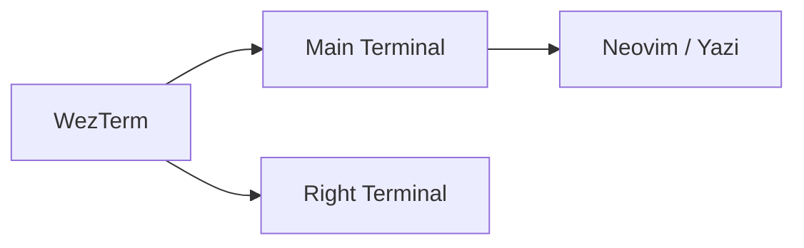
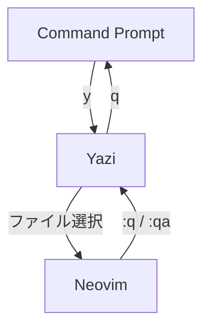

# README  

初回更新日: 2026/08/09(日)  
最終更新日: 2026/11/19(木)  
作成者: norder, Gemini 3.6 Flash

`#Neovim` `#WezTerm` `#Yazi` `#環境構築`  
`#neovim` `#wezterm` `#yazi` `#setup`  

## 1. 概要  

### 1.1. はじめに  

本備忘録は, Windows環境において **Neovim・WezTerm・Yazi** を導入し, 自分の設定を別のPCへ移行する際に, 可能な限り迷わず環境を再構築できるようにすることを目的とした備忘録です.  

本環境では, 主に以下の3つのツールを組み合わせて使用します.  

- **Neovim:** メインエディタ  
- **WezTerm:** ターミナルエミュレータ  
- **Yazi:** ターミナルファイルマネージャ  

設定ファイルはGitHub上で管理しており, 本備忘録と設定ファイルを合わせて利用することで, 新しいPCでも同様の開発環境を構築できるようにします.  

また, 本備忘録ではWindows環境での導入を前提としています.  

### 1.2. 使用環境  

**OS:** Windows 11  
**Shell:** Command Prompt  
**Editor:** Neovim  
**Terminal:** WezTerm  
**File Manager:** Yazi  

### 1.3. 全体構成  


基本的には, **WezTermを起動し, その中でCommand Prompt・Yazi・Neovimを使用する**構成です.  


## 2. 前提条件  

### 2.1. 必要なソフトウェア  

以下のソフトウェアを使用します.  

| ソフトウェア    | 用途                                  |  
|:---------------:|:--------------------------------------|  
| Git for Windows | Gitの利用およびYaziの`file.exe`       |  
| Rust / Cargo    | Tree-sitter CLIの導入                 |  
| Neovim          | テキストエディタ                      |  
| WezTerm         | ターミナルエミュレータ                |  
| Yazi            | ターミナルファイルマネージャ          |  
| ripgrep         | Neovimなどからの高速検索              |  
| fd              | Yaziからのファイル検索                |  
| fzf             | YaziやNvimで使える検索ツール          |  
| Cica            | ソフトウェアではなく, フォント        |  
| zenhan          | IMEをコマンドから切り替えられるツール |  

### 2.2. 推奨する導入順序  

新しいPCでは, 以下の順番で導入してください.  

1. Git for Windows  
2. Rust / Cargo  
3. ripgrep  
4. fd  
5. fzf  
6. Tree-sitter CLI  
7. zenhan  
8. Neovim  
9. WezTerm  
10. Yazi  
11. Cica  
12. Neovim設定  
13. WezTerm設定  
14. Yazi設定  
15. 各ツールの動作確認  

依存関係のあるツールを先に導入することで, 設定ファイルを配置した後のトラブルを減らします.  


## 3. 共通環境の導入  

### 3.1. Git for Windows  

YaziではWindows上でファイルのMIME typeを判定するために`file.exe`を利用します.  
Yazi公式ドキュメントでは, WindowsではGit for Windowsに含まれる`file.exe`を利用する方法が推奨されています.  

Gitが未導入の場合は, 以下を実行してください.  

```cmd  
winget install Git.Git  
```  

インストール後, Command Promptを再起動してください.  

Gitが正しく導入されていることを確認します.  

```cmd  
git --version  
```  

また, Git for Windowsの`file.exe`が以下に存在することを確認してください.  

```text  
C:\Program Files\Git\usr\bin\file.exe  
```  

必要に応じて, 環境変数`YAZI_FILE_ONE`に以下のパスを設定します.  

```text  
C:\Program Files\Git\usr\bin\file.exe  
```  

### 3.2. Rust / Cargo  

Tree-sitter CLIをCargoから導入するためにRustが必要です.  

Rustが未導入の場合は, Rust公式のインストーラを使用して導入してください.  

導入後, 以下のコマンドで確認します.  

```cmd  
rustc --version  
cargo --version  
```  

### 3.3. ripgrep  

Neovimの検索機能などで使用するため, ripgrepを導入します.  

```cmd  
winget install BurntSushi.ripgrep.MSVC  
```  

導入後, 以下で確認します.  

```cmd  
rg --version  
```  

### 3.4. fd  

Yaziでのファイル検索などに使用するため, `fd`を導入します.  

```cmd  
winget install sharkdp.fd  
```  

導入後, 以下で確認します.  

```cmd  
fd --version  
```  

### 3.4. fzf  

Yaziでのファイル検索やNvimでの検索に使用するため, `fzf`を導入します.  

```cmd  
winget install junegunn.fzf  
```  

導入後, 以下で確認します.  

```cmd  
fzf --version  
```  

### 3.5. Tree-sitter CLI  

NeovimのTree-sitter関連機能で使用するため, Tree-sitter CLIを導入します.  

```cmd  
cargo install tree-sitter-cli --locked  
```  

導入後, 以下で確認します.  

```cmd  
tree-sitter --version  
```  

### 3.5. zenhan  

Neovimで, 日本語切り替えの際の手間を軽減するため, 導入します.  

対応するOSのものを以下のGithubのURLからダウンロード・インストールしてください.  

[Github: iuchim/zenhan](https://github.com/iuchim/zenhan)  

その後, 環境変数にパスを通し, 以下で全角半角が切り替わることを確認します.  

```cmd  
zenhan 0  
zenhan 1  
```  

## 4. Neovim  

### 4.1. 概要  

Neovimをメインエディタとして使用します.  

設定ファイルはGitHubで管理しており, Windowsでは以下のディレクトリをNeovimの設定ディレクトリとして使用します.  

```text  
%LOCALAPPDATA%\nvim  
```  

NeovimはWindowsの標準設定ディレクトリとして`%LOCALAPPDATA%\nvim`を使用します.  

### 4.2. 導入手順  

#### 4.2.1. Neovim本体の導入  

以下を実行してください.  

```cmd  
winget install Neovim.Neovim  
```  

導入後, 以下で確認します.  

```cmd  
nvim --version  
```  

### 4.3. 設定ファイルの配置  

Neovimの設定ディレクトリを作成します.  

```cmd  
mkdir "%LOCALAPPDATA%\nvim"  
```  

GitHubに保存している`Neovim`フォルダの**中身**を以下へコピーしてください.  

```text  
%LOCALAPPDATA%\nvim\  
```  

最終的な構成は以下のようになります.  

```text  
%LOCALAPPDATA%\nvim\  
├── init.lua  
└── lua\  
    ├── autocmd.lua  
    ├── keymaps.lua  
    ├── options.lua  
    └── plugins.lua  
```  

### 4.4. 初回起動  

Command Promptから以下を実行してください.  

```cmd  
nvim  
```  

初回起動時には, lazy.nvimなどのプラグインマネージャによってプラグインのインストールが行われる場合があります.  

プラグインのインストールが完了するまで待ってください.  

その後, Neovimを一度終了して再起動してください.  

### 4.5. 動作確認  

Neovim内で以下を確認してください.  

```vim  
:checkhealth  
```  

プラグイン管理には以下を使用します.  

```vim  
:Lazy  
```  

### 4.6. ディレクトリ構造  

```text
nvim/
├── init.lua
└── lua/
    ├── autocmd.lua
    ├── keymaps.lua
    ├── options.lua
    └── plugins.lua
```  

### 4.7. 重要なキーバインド  

以下は, 独自設定の中でも特に使用頻度が高いものです.  

| キー         | モード          | 説明                                         |  
|:------------:|:---------------:|:---------------------------------------------|  
| `<C-h>`      | Insert          | カーソルを左へ移動                           |  
| `<C-j>`      | Insert          | カーソルを下へ移動                           |  
| `<C-k>`      | Insert          | カーソルを上へ移動                           |  
| `<C-l>`      | Insert          | カーソルを右へ移動                           |  
| `<C-h>`      | Normal          | 前のバッファへ移動                           |  
| `<C-l>`      | Normal          | 次のバッファへ移動                           |  
| `:bd`        | Command         | 現在のバッファを削除                         |  
| `<leader>d`  | Normal          | Yaziファイラを開く                           |  
| `<leader>c`  | Normal / Visual | コメントを切り替え                           |  
| `<leader>tp` | Normal          | プロジェクト内のTODOなどのタグを検索         |  
| `<leader>tl` | Normal          | 現在のファイル内のTODOなどのタグを検索       |  
| `<leader>m`  | Normal          | ファイルの, や. の変換や行末のスペースを追加 |  
| `<leader>ff` | Normal          | fzfファイル検索                              |  
| `<leader>fg` | Normal          | fzf文字列検索                                |  
| `<leader>fb` | Normal          | fzfバッファ検索                              |  
| `<leader>fh` | Normal          | fzfファイル履歴検索                          |  
| `<leader>fc` | Normal          | fzfコミット履歴検索                          |  

`<leader>`は`<Space>`に設定しています.  


## 5. WezTerm  

### 5.1. 概要  

WezTermをメインのターミナルエミュレータとして使用します.  

設定ファイルは複数ファイルに分割して管理しています.  

### 5.2. 導入手順  

以下を実行してください.  

```cmd  
winget install wez.wezterm  
```  

導入後, 以下で確認します.  

```cmd  
wezterm --version  
```  

### 5.3. 設定ファイルの配置  

本環境では, 以下のディレクトリを使用します.  

```text  
%USERPROFILE%\.config\wezterm\  
```  

ディレクトリが存在しない場合は作成してください.  

```cmd  
mkdir "%USERPROFILE%\.config\wezterm"  
```  

GitHubに保存している`WezTerm`フォルダの中身を以下へコピーしてください.  

```text  
%USERPROFILE%\.config\wezterm\  
```  

最終的な構成は以下のようになります.  

```text  
%USERPROFILE%\.config\wezterm\  
├── keybind.lua  
└── wezterm.lua  
```  

WezTermはWindowsでも`%USERPROFILE%\.config\wezterm\wezterm.lua`を設定ファイルとして利用できます.  

### 5.4. 設定の反映  

WezTerm起動中に設定を変更した場合は, 以下で設定を再読み込みできます.  

```text  
Ctrl + Shift + R  
```  

設定ファイルにエラーがある場合は, WezTermの起動時や再読み込み時にエラーが表示されるため確認してください.  

### 5.5. キーバインド  

|キー |説明 |  
|:---: |:--- |  
|`Alt + D` |下方向にTerminalを追加 |  
|`Alt + R` |右方向にTerminalを追加 |  
|`Alt + W` |現在のPaneを閉じる |  
|`Alt + H` |左のPaneへ移動 |  
|`Alt + J` |下のPaneへ移動 |  
|`Alt + K` |上のPaneへ移動 |  
|`Alt + L` |右のPaneへ移動 |  

### 5.6. 基本的な使用方法  

基本的には, 以下のようなレイアウトで使用します.  



必要に応じて`Alt + R`や`Alt + D`でPaneを追加し, `Alt + H/J/K/L`でPane間を移動します.  


## 6. Yazi  

### 6.1. 概要  

Yaziをターミナル上で使用するファイルマネージャとして利用します.  

Yaziからファイルを選択し, Neovimで編集することを基本的な操作とします.  

### 6.2. 導入手順  

以下を実行してください.  

```cmd  
winget install sxyazi.yazi  
```  

導入後, 以下で確認します.  

```cmd  
yazi --version  
```  

### 6.3. 設定ファイルの配置  

WindowsにおけるYaziの設定ディレクトリは以下です.  

```text  
%APPDATA%\Roaming\yazi\config\  
```  

ディレクトリが存在しない場合は作成してください.  

```cmd  
mkdir "%APPDATA%\Roaming\yazi\config"  
```  

GitHubに保存している`Yazi`フォルダの中身を以下へコピーしてください.  

```text  
%APPDATA%\Roaming\yazi\config\  
```  

最終的な構成は以下のようになります.  

```text  
%APPDATA%\Roaming\yazi\config\  
├── keymap.toml  
├── theme.toml  
└── yazi.toml  
```  

### 6.4. `y.bat`の配置  

Yazi終了後も, Yazi内で最後に移動していたディレクトリをCommand Promptのカレントディレクトリとして引き継ぐため, `y.bat`を使用します.  

`y.bat`はPATHの通ったディレクトリに配置してください.  

例として, 以下のようなディレクトリを使用できます.  

```text  
%USERPROFILE%\bin\  
```  

その場合は, 以下のような構成になります.  

```text  
%USERPROFILE%\bin\  
└── y.bat  
```  

`y.bat`の内容は以下です.  

```bat  
@echo off  

set tmpfile=%TEMP%\yazi-cwd.%random%  

yazi.exe %* --cwd-file="%tmpfile%"  

if not exist "%tmpfile%" exit /b 0  

set /p cwd=<"%tmpfile%"  

if not "%cwd%"=="" if exist "%cwd%\" (  
    cd /d "%cwd%"  
)  

del "%tmpfile%"  
```  

この`y.bat`がPATH上に存在することを確認してください.  

```cmd  
where y  
```  

### 6.5. Yaziの起動  

以下のコマンドで起動できます.  

```cmd  
y  
```  

Yaziを終了した後も, Yazi内で移動していたディレクトリがCommand Promptへ引き継がれます.  

### 6.6. Windowsにおける`file.exe`の設定  

YaziはWindows上でMIME typeの判定に`file.exe`を利用します.  

Git for Windowsを標準的な場所へインストールしている場合, 以下に存在します.  

```text  
C:\Program Files\Git\usr\bin\file.exe  
```  

必要に応じて, 環境変数`YAZI_FILE_ONE`へこのパスを設定してください.  

### 6.7. キーバインド  

|キー |説明 |  
|:---: |:--- |  
|`:` |Command入力 |  
|`.` |隠しファイル表示の切り替え |  
|`~` |キーバインドヘルプを表示 |  
|`Space` |ファイルを選択 |  
|`y` |ファイルをヤンク |  
|`c` |パスをコピー |  
|`f` |リアルタイムでファイルを絞り込み |  
|`s` |`fd`によるファイル検索 |  
|`S` |`rg`によるファイル内文字列 |  
|`z` |`fzf`によるリアルタイムファイル検索 |  
|`tt` |新しいタブを作成 |  
|`1` ～ `9` |タブを移動 |  
|`<C-t>` |現在のタブを閉じる |  
|`q` |Yaziを終了 |  

### 6.8. Neovimとの連携  

Yaziからファイルを選択し, `Enter`などの設定済み操作によってNeovimでファイルを開きます.  

基本的な操作の流れは以下です.  




## 7. 基本的な使用フロー  

### 7.1. 起動から終了まで  

普段の使用では, 以下の流れを基本とします.  

1. WezTermを起動します.  
2. 必要に応じて`Alt + R`または`Alt + D`でPaneを追加します.  
3. `y`を実行してYaziを起動します.  
4. Yaziで`f`または`s`を使用してファイルを検索します.  
5. ファイルを選択してNeovimで開きます.  
6. Neovimで編集します.  
7. `:w`で保存します.  
8. `:q`または`:qa`でNeovimを終了します.  
9. Yaziへ戻った場合は`q`で終了します.  
10. 必要に応じてCommand Promptで`exit`を実行します.  

### 7.2. 典型的な操作例  

```text  
WezTerm  
  ↓  
Command Prompt  
  ↓  
y  
  ↓  
Yazi  
  ↓  
ファイル検索  
  ↓  
Neovim  
  ↓  
編集・保存  
  ↓  
:q  
  ↓  
Yazi  
  ↓  
q  
  ↓  
Command Prompt  
```  


## 8. 新しいPCへの移行手順  

### 8.1. 最初に行うこと  

新しいPCでは, 前述の順番で必要なツールのインストールを完了させてください.  

### 8.2. 設定ファイルの配置  

以下の3か所へ設定ファイルをコピーしてください.  

**Neovim**  

```text  
%LOCALAPPDATA%\nvim\  
```  

**WezTerm**  

```text  
%USERPROFILE%\.config\wezterm\  
```  

**Yazi**  

```text  
%APPDATA%\yazi\config\  
```  

さらに, `y.bat`をPATHの通ったディレクトリへ配置してください.  

### 8.3. PATHの確認  

新しいCommand Promptを開き, 以下を確認してください.  

```cmd  
where nvim  
where wezterm  
where yazi  
where y  
where rg  
where fd  
where fzf  
where tree-sitter  
where git  
where zenhan  
```  

すべて必要な実行ファイルが見つかれば, 基本的なPATH設定は完了です.  

### 8.4. 最終確認  

以下を順番に確認してください.  

```cmd  
nvim  
```  

Neovimが起動し, プラグインが読み込まれることを確認します.  

```cmd  
wezterm  
```  

WezTermが起動し, 設定が反映されていることを確認します.  

```cmd  
y  
```  

Yaziが起動し, ファイル検索およびNeovimとの連携が動作することを確認します.  

### 8.5. トラブル発生時の確認  

問題が発生した場合は, 以下を順番に確認してください.  

1. Command Promptを再起動してください.  
2. `where <command>`でPATHを確認してください.  
3. 各ツールの`--version`でインストール状態を確認してください.  
4. Neovimでは`:checkhealth`を実行してください.  
5. Neovimのプラグイン管理画面でプラグインのインストール状態を確認してください.  
6. 設定ファイルの配置場所が正しいか確認してください.  
7. 設定ファイル内で外部コマンドを直接指定している場合は, そのコマンドが新しいPCにも存在するか確認してください.  


## 9. 設定ファイルの管理  

### 9.1. GitHubとの対応  

設定ファイルはGitHub上で管理しています.  

各ツールの設定ファイルを変更した場合は, 新しいPCへ移行する際にも変更内容が反映されるよう, GitHub側の設定ファイルも更新してください.  

### 9.2. 設定ファイルを変更した場合  

設定ファイルを変更した場合は, 以下を確認してください.  

- 新しいファイルが追加されていないか  
- 外部コマンドへの依存が追加されていないか  
- PATHへの追加が必要になっていないか  
- プラグインやLSPなどの追加導入が必要になっていないか  
- キーバインドを変更していないか  
- このREADMEの導入手順を変更する必要がないか  

特に, **新しいPCで設定ファイルをコピーするだけでは動作しないもの**を追加した場合は, 必ず本READMEにも導入手順を追加してください.  

